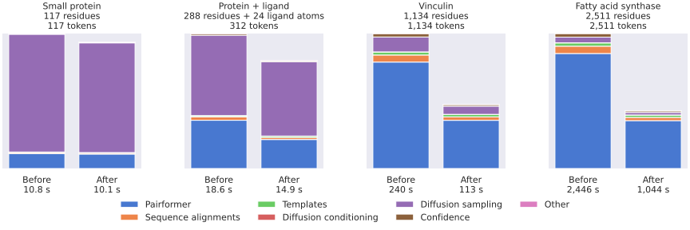

# boltz-lumi

boltz-lumi adds ROCm kernels to Boltz-2 for inference on LUMI's MI250X GPUs.

## Performance



The baseline is Boltz 2.2.1 with `--no_kernels`. For the protein–ligand case,
startup added about 40 seconds, plus another 90 seconds when kernels first
compiled. Other overhead, including output writes, was under a second per
prediction.

## Versions

Versions follow `<Boltz version>.<adapter revision>`. For example, `2.2.1.0`
is the first adapter release for Boltz 2.2.1, and `2.2.1.1` updates the adapter
for the same Boltz release. Development versions end in `.devN`.
A new Boltz version starts a new adapter series after compatibility validation.

## Setup

Use a GPU allocation for setup, inference and checks. The tested stack is
Boltz 2.2.1, ROCm 7.2.4, PyTorch 2.11.0, Triton 3.6 and Python 3.12, in
`lumi-multitorch-torch-u24r72f21m50t211-20260929_104918.sif`.
PyTorch, Triton and ROCm come from the image. `requirements.txt` selects Boltz
and NumPy; `container-constraints.txt` pins Boltz dependency versions for the
environment built on this container.

```bash
cp .env.example .env
# Set your GPU account, workspace and container path in .env.
export BOLTZ_LUMI_ENV="$PWD/.env"
source "$BOLTZ_LUMI_ENV"
sbatch --account="$BOLTZ_LUMI_ACCOUNT" scripts/lumi.sbatch setup
```

Boltz downloads model files on first use. Kernels compile into the workspace
and are cached for later runs.

## Run inference

After setup finishes, run from this directory:

```bash
sbatch --account="$BOLTZ_LUMI_ACCOUNT" scripts/lumi.sbatch \
  python -m boltz_lumi predict inputs/protein_ligand.yaml \
  --out_dir "$BOLTZ_LUMI_WORK/prediction"
```

This uses Boltz's CLI, with the same inputs, options and output layout.
For example, add `--use_msa_server`, `--diffusion_samples 5` or
`--output_format pdb`. Pass a directory to predict several inputs.

Structures and confidence files are written under
`prediction/boltz_results_protein_ligand/predictions/`. Affinity predictions
are enabled through the input YAML, as in Boltz.

## Compare and profile

```bash
sbatch --account="$BOLTZ_LUMI_ACCOUNT" scripts/lumi.sbatch \
  python -m boltz_lumi.benchmark inputs/protein_ligand.yaml --repeats 3 \
  --out_dir "$BOLTZ_LUMI_WORK/comparison"
```

The comparison runs both versions on one GPU with matched inputs and seeds,
one first call and three warm repeats. Reports under
`boltz_results_protein_ligand/benchmark/` contain timings, peak memory and
numerical differences. They separate first calls, warm model calls and complete
rounds, using the existing compilation cache.

Add `--profile` to save an operator summary and a full trace in a separate round.
Profiling is excluded from the latency measurements.

The example job has a two-hour limit. Increase it for repeated large-input
comparisons, for example with `sbatch --time=06:00:00 ...`.

## Checks

Inside a GPU allocation with the site environment selected:

```bash
bash scripts/lumi.sh python tests/test_operator_additions.py
bash scripts/lumi.sh python tests/test_atom_conditioning.py
bash scripts/lumi.sh python tests/test_triangle_softmax.py
bash scripts/lumi.sh python tests/test_pair_transition.py
bash scripts/lumi.sh python tests/test_workflow.py
```

Regenerate the figure with `python scripts/plot_benchmarks.py` (requires Matplotlib and Seaborn).
Third-party licenses are listed in [source notices](third_party/README.md).
